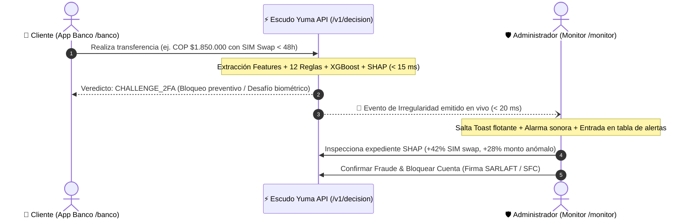

# 🛡️ Escudo Yuma - Sistema Antifraude en Tiempo Real

> **Sistema de Detección y Prevención Pre-Transaccional de Fraude para la Billetera Digital Colombiana Yuma Pay (SEDPE).**  
> 100% Código Abierto • 2 Páginas Especializadas (App Banco + Monitor Admin) • Gestor Dinámico de Reglas • Notificaciones de Alerta en Tiempo Real • Latencia P99 < 15 ms (SLA < 300 ms) • Explicabilidad Regulatoria SHAP • Conforme a SFC, Ley 1581 de 2012 y SARLAFT.

---

## 🌐 1. Arquitectura de las 2 Páginas Interactivas (PoC en Vivo)

Hemos retirado la sección genérica de simulación y desacoplado el sistema en **dos experiencias independientes y conectadas en tiempo real**:

| Entorno | URL | Descripción |
| :--- | :--- | :--- |
| **📱 App del Banco (Cliente)** | [http://localhost:8000/banco](http://localhost:8000/banco) | Billetera digital móvil Yuma Pay. Permite consultar saldo, transferir dinero a Nequi/Bancolombia/QR y probar escenarios con comprobantes bancarios y desafíos biométricos. |
| **🛡️ Monitor del Administrador** | [http://localhost:8000/monitor](http://localhost:8000/monitor) | Centro de Operaciones de Seguridad (SOC). Recibe notificaciones y alarmas sonoras en vivo de irregularidades, gestiona reglas dinámicas e inspecciona explicabilidad SHAP. |
| **⚡ Hub & Pantalla Dividida** | [http://localhost:8000/](http://localhost:8000/) | Menú principal con opción de **Demostración en Pantalla Dividida (Split-Screen)** para operar el celular a la izquierda y ver cómo salta la alerta en el monitor a la derecha. |

---

## 🔄 2. Flujo de Notificación en Tiempo Real entre Banco y Monitor



---

## ⚖️ 3. Cómo Crear Nuestras Propias Reglas Antifraude

Los analistas pueden definir reglas personalizadas desde la interfaz del monitor o vía API:

1. Ingresa a **[http://localhost:8000/monitor](http://localhost:8000/monitor)** en la pestaña **«Gestor de Reglas Antifraude»**.
2. Haz click en **«Crear Nueva Regla»**.
3. Configura los parámetros:
   - **ID:** `CUSTOM_TOPE_PSE_2M`
   - **Nombre:** *Bloqueo preventivo de transferencias > 2M por canal PSE*
   - **Tipo:** `HARD_BLOCK` (Rechazo preventivo) o `CHALLENGE` (Biometría 2FA)
   - **Variable:** `amount`
   - **Operador:** `>`
   - **Valor Umbral:** `2000000`
   - **Descripción:** *Justificación regulatoria para la SFC*
4. Guarda la regla (se activa de inmediato en caliente).
5. Abre la **[App del Banco](http://localhost:8000/banco)**, intenta enviar COP $2.500.000 por PSE y presiona **«Confirmar y Enviar»**.
6. **Efecto Inmediato:**
   - La App del banco bloqueará la transacción.
   - En el **Monitor del Administrador** sonará la alarma y saltará la notificación en vivo mostrando que se disparó la regla `CUSTOM_TOPE_PSE_2M`.

---

## 🚀 4. Comandos de Ejecución y Pruebas

```bash
# Iniciar la plataforma completa en tu máquina:
uvicorn app.main:app --host 0.0.0.0 --port 8000 --reload

# Correr las pruebas unitarias completas:
python3 -m pytest tests/ -v
```
